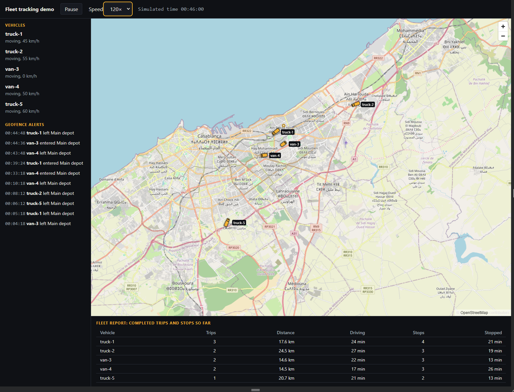

# Fleet Tracking Demo

A small simulated fleet, and the code that turns raw GPS positions into
geofence alerts, trips, stops and a per-vehicle report.



**Live demo:** https://fleet-tracking-demo.zerrouk-zakaria.workers.dev (runs the simulator and detection logic in your browser, with no MQTT or database)

I built this on my own to show the kind of problems I worked on professionally:
geolocation, geofencing, and turning a stream of telemetry into something
useful. All the code is original and all the data is made up. The vehicles,
routes and places are invented for the demo.

You can run it two ways. In the browser, the simulator and the detection logic
run in the page itself, which makes it easy to host for free. Or you can run it
as an actual pipeline with Docker: a publisher sends positions over MQTT, an
ingest service checks them and runs the same detection code, and PostgreSQL
stores the results.

## What it does

- Moves five vehicles along looping routes around Casablanca and Mohammedia,
  with some simulated GPS noise (up to 4 m on each axis).
- Raises an alert when a vehicle enters or leaves a circular zone. There's one
  zone, the depot.
- Detects stops (parked for 3 minutes or more) and the trips between them.
- Totals trips, distance, driving time and stopped time for each vehicle.

## How it's put together

```
Browser demo:   simulator -> detectors -> map, alerts, report

Docker pipeline:
  publisher --MQTT--> Mosquitto --MQTT--> ingest --> PostgreSQL
  (simulator)         (broker)            (validate + detectors)
```

```
packages/core/       the logic, plain TypeScript, with unit tests
apps/web/            browser demo (Vite, React, MapLibre)
services/publisher/  runs the simulator and publishes positions to MQTT
services/ingest/     subscribes, validates, runs the detectors, writes to Postgres
docker/              Mosquitto config and the PostgreSQL schema
```

The detection logic all lives in `packages/core` as ordinary functions that
know nothing about the browser, MQTT or the database. The browser demo and the
ingest service call the same code, and I test it on its own.

## Running it

You need Node.js 22 (it's what the Docker image uses). For the pipeline you
also need Docker Desktop, and it has to be running before you start.

Browser demo:

```bash
npm install
npm run dev
```

Then open the address Vite prints, usually http://localhost:5173.

Full pipeline:

```bash
docker compose up -d --build
```

That starts Mosquitto, PostgreSQL, the ingest service and the publisher. The
publisher runs at 10x real time by default. To go faster, set `SIM_SPEED`
first, for example `$env:SIM_SPEED = "60"` in PowerShell or
`SIM_SPEED=60 docker compose up -d --build` on macOS and Linux.

To see what's happening:

```bash
docker compose logs ingest --tail 5
docker compose exec postgres psql -U fleet -d fleet -c "SELECT vehicle_id, round(distance_m::numeric) AS meters, ended_at - started_at AS duration FROM trips ORDER BY started_at;"
docker compose exec postgres psql -U fleet -d fleet -c "SELECT vehicle_id, event_type, occurred_at FROM geofence_events ORDER BY occurred_at;"
```

`docker compose down` stops everything and keeps the data. `docker compose down -v`
also deletes the database. The schema in `docker/postgres/init.sql` only runs
on an empty database, so if you change it you need `down -v` to see the change.

Tests:

```bash
npm test
npm run typecheck
```

There are 58 unit tests covering the code in `packages/core`. Some of the
expected values I worked out by hand, like a simulated 3 km route and the
trips, stops and geofence events it should produce.

## Decisions worth explaining

I detect stops by how long a vehicle stays put, not by its speed. If a parked
vehicle's GPS drifts 5 m in a second, speed calculated from two points says
it's doing 18 km/h. Staying within 50 m of one spot for 3 minutes is a much more
reliable signal.

Geofence exits need a buffer. A vehicle has to get 20 m past the edge of the
zone before it counts as having left. Without that, GPS jitter around the
boundary produces a stream of fake enter and exit events.

A stop can only be confirmed 3 minutes after it starts, so when a trip is
reported I give it the time the vehicle actually arrived, not the time I
noticed.

The ingest service has rules for messages that arrive out of order. A position
at or before the vehicle's last timestamp is dropped. One that's more than an
hour earlier is treated as the stream restarting, so the open trip or stop is
saved and the vehicle starts fresh. It also rejects bad JSON, out-of-range
values, oversized payloads, and messages where the topic and the vehicle id
don't match.

I don't store raw positions. At the default speed that would be over 400,000
rows a day and nothing here needs them. The downside is that I can't replay
history or recalculate it later.

I used the `pg` driver with plain SQL. Four small tables didn't seem to need an
ORM or a migration tool. I left Kafka out because a fleet this size doesn't
need it.

## Limitations

This is a demo, not production software, and the data is synthetic.

Vehicles drive in straight lines at constant speed instead of following roads,
so on the map they sometimes cut across buildings or the coast. The coordinates
are approximate points I picked, not surveyed locations.

A trip can end up to about 50 m short of where the vehicle actually stopped,
because it ends at the last point more than 50 m from the stop reference.

Reports run about 3 minutes behind, since a stop is only confirmed after 3
minutes and a trip only counts once it's finished.

The detectors keep their state in memory. If you restart the ingest service,
any trip or stop in progress is lost. Anything already finished is in the
database. If a database write fails, the results for that one message are also
lost, because the detectors have already moved on. The failure is logged and
counted.

MQTT delivery is at most once (QoS 0), so a lost message isn't re-sent. Because
of the in-memory state, you can only run one ingest instance. Several would
each see part of a vehicle's data.

There's no authentication. The broker accepts anonymous connections and the
database uses a throwaway password from `docker-compose.yml`. Both ports only
listen on `127.0.0.1`, so only your own machine can reach them, but don't treat
this as a secure setup.

The hosted browser demo runs the same detection code but doesn't use MQTT or a
database, so it only simulates the pipeline.

The publisher and ingest services don't have automated tests. I checked them by
running the whole pipeline, looking at what ended up in the database, and
restarting the broker to see them reconnect. The logic they rely on is
unit-tested.

The Docker image is bigger than it should be, because one Dockerfile installs
every workspace's dependencies to keep things simple.

## Map data

The map uses OpenStreetMap tiles under their
[tile usage policy](https://operations.osmfoundation.org/policies/tiles/), with
attribution on the map. That service is best-effort, so you can swap the tile
source with the `VITE_TILE_URL` environment variable.